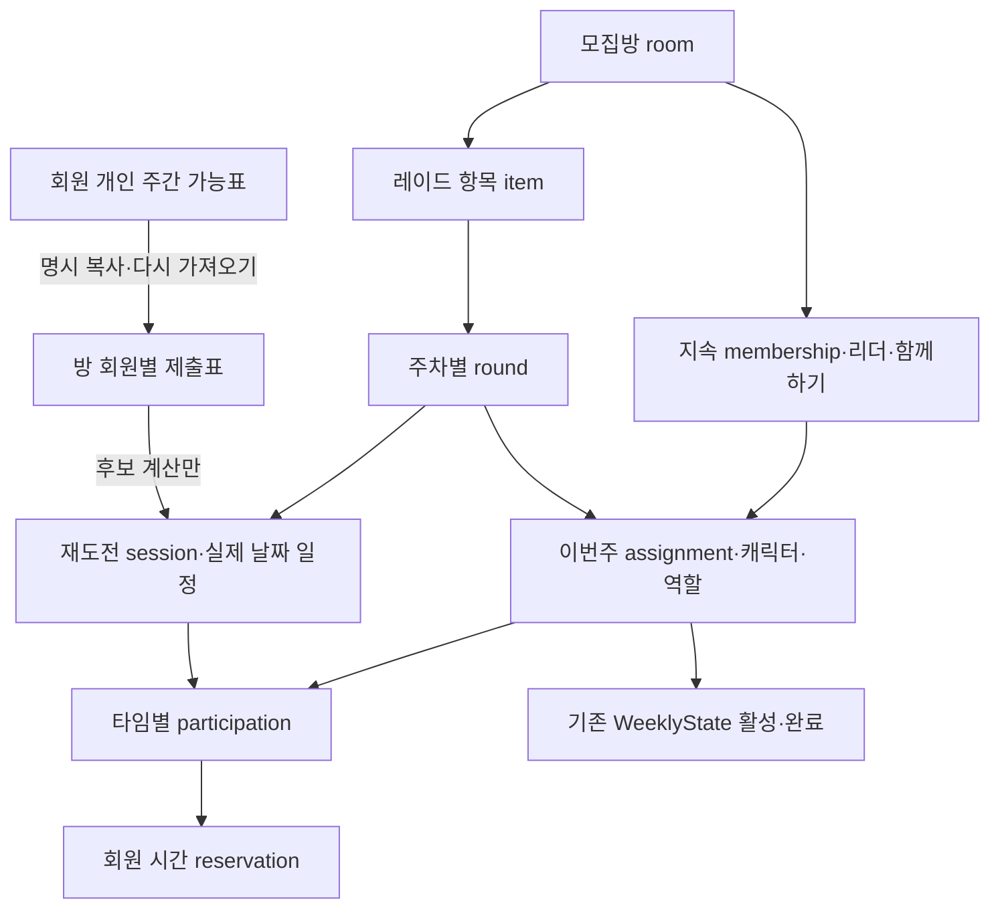

# #13 통합 모집 경계·명령·소비 계약 기획안

2026-10-19 / Backend / feat/raid-recruitment / 기준8178c87. **검토용 제안이며 경계 합의·최종 API·구현 완료가 아니다.** 근거와 정정 순서는 [수신대장](ISSUE_13_INTEGRATED_REQUIREMENTS_INTAKE.md)의 Flutter24~29번째 및21~22번째를 따른다. 27번째 통합목표를 유지하고 설계확정 뒤 내부 구현단계만 나눈다.

## 1. 구조와 수명 제안

현재 단일 Round/Membership을 그대로 확대하면 다음주 구성과 이번주 점유를 분리할 수 없다. 아래 식별·관계를 최소 도메인 경계로 제안한다. 한 행에 모든 상태를 몰거나 지금 장래 프레임워크를 만들지 않는다.

| 자원/UUID | 소유·권한 | 수명/불변조건 |
|---|---|---|
| personal availability | 본인 회원만 GET/PUT | 주간 템플릿, 캐릭터/방과독립. 저장만으로예약/완료생성없음 |
| room / membership | 세션회원·현참가자/리더 | 방정체성/지속자리·다음주함께하기. 그룹membership과분리, 탈퇴/종료때만종료 |
| room submission | 본인작성, 해당방참가자에게제출표공개 | membership+제출revision+원본개인표version을보존. 개인표편집이자동전파되지않음 |
| raid item | room에속함 | raid/difficulty·catalog선택단위. 최초부터item_id발급, 단일레이드도1개item |
| round | item+cycle_key별 | 이번주진행/result·target UUID. open/completed/stopped_incomplete를분리. 다음주새round는별도명령/정책 |
| assignment | membership+round별 | 그주선택캐릭터/역할·snapshot·상태. 종료후지속membership만으로재생성불가 |
| session / participation | round아래타임 / assignment별 | 같은raid의7회재도전은7session, WeeklyState참가/완료7개가아님. 필수/선택과본인명시참가구분 |
| reservation | 회원+session/participation별 | 확정된UTC [start,end)만점유. release시삭제하지않고사유/시각보존, 과거ACK로재생성불가 |

assignment를 현원장의 참가근거로 삼고 WeeklyState는 기존(user, character, raid, cycle) 단일 권위 원장을 재사용한다. 실제예약은 회원(user) 단위이므로 다른원정대/캐릭터로시간겹침을우회하지못한다. reservation은WeeklyState를대체하지않고역할을분리한다.

room_id는공통진입/한도·지속그룹, item/round/session_id는명령대상을특정한다. 단일API도응답에이를명시해다중확장때ID의미를바꾸지않는다. 묶음참가/전체탈퇴·부분완료정책은별도결정전까지단일item이외실행을열지않되통합설계범위에서는영향을확정한다.

## 2. 개인 가능표·복사 계약 제안

**후보 경로** GET/PUT /v1/me/play-availability. 본인세션/서버회원scope이며인증원정대보유는저장조건으로추가하지않는안을추천한다. ‘미저장’과‘저장된빈표’를구분하고GET가행을생성하지않는다.

- 시간대 Asia/Seoul 고정, 요일 ISO1월~7일, local start/end HH:mm 5분단위, end_day_offset=0|1. 24:00 문자열대신00:00/offset1 사용. 시작과종료가같고offset0은거절, offset1은24시간으로구분한다.
- 입력 interval은0보다크고24시간이하. 예: weekday=7/start=23:55/end=00:10/offset1은일요일밤~월요일새벽15분이다.
- 제안상한 원시64구간/정규화64구간. 같은요일복수구간허용, 중복·인접은합치고익일/주말경계는분할후정렬한다. 주간표의겹침을저장실패로만들지않고정규화결과를반환한다. 상한은합의전값이다.
- PUT 전체교체 + expected_version + UUIDv4 Idempotency-Key. timezone/intervals필수, []는의도적가능시간없음. 최초가상version1, 성공변경시증가/no-op유지, stale409·잘못된입력400·타인scope없음. 초기값은전시간가능이아니다.
- GET/PUT 응답후보: {exists,version,timezone,intervals,updated_at}. 없을때 exists=false/version1/intervals=[]/updated_at=null. GUI접힘/취소는Flutter로컬동작이며취소PUT는없다. 복구는원ACK와현재GET를구분한다.
- 방별복사명령은 expected_personal_version/expected_submission_revision/expected_membership_revision을받아현재본인표를복사한다. 개인표가바뀌었으면409. 복사후개인표변경은기존제출표/확정예약에영향없음.
- 다시가져오기는명시snapshot교체이며현재확정시간을자동이동하지않는다. 확정예약을수용못하는새제출표는직접반영을거절하고일정변경/탈퇴로안내하는안을추천한다.
- 모집응답은해당방membership참조·제출표와공통후보만공개. 다른방예약세부/개인표전체·전역user UUID는표시하지않고후보차감결과만반영한다.

## 3. 일정·유한 후보·마감 제안

- 일정모드 unscheduled/manual/coordinated와상태 unconfirmed/confirmed/change_pending을분리한다. 미정/클리어시까지는null/명시enum으로유지하고유한구간을만들지않는다. 자동조율예약확정에는유한최대플레이기간이필요하다.
- 주간template→현재cycle의실제KST날짜구간→UTC [start,end)로확장하고cycle창과교차한다. cycle키는수06시유지, 수10시플레이창은별도정책확정전하드코딩하지않는다. 다음주카드/과거이력은현재후보탐색에섞지않는다.
- 서버저장 room.created_at+30분은고정출발하한이다. 후보는5분격자, 기간은10분이상/5분단위제안이며수동최대시간1~24시간요구와자동조율 기간상한은 별도 입력 제약으로 확인해야 한다.
- 대상membership/해당타임필수또는명시참가assignment의제출표교집합에서각회원의다른활성예약을차감하고기간전체가들어가는후보를오름차순탐색한다. 본session교체시그session의기존예약만제외해자기자신과충돌시키지않는다.
- 현재주차7일·5분격자최대2016시작점과방최대8명의유한탐색을초기안으로삼되부하보장이아니다. 타임일괄조회/편집을쓰고7타임이면7화면요청을강제하지않는다. 다중타임동시배치의경우입력타임순서로가예약누적후검사하는안을추천하며전역재최적화/기존확정재배치는하지않는다. 서로독립최선선택이전체해를보장하지않는한계를대조한다.
- earliest/latest 후보와공대장상한을명시하고실제확정시각은별도다. 마지막출발가능시각=min(기간충족공통최후후보,공대장상한). 후보없음이기존참가자동해제/다른시각자동이동을뜻하지않는다.
- 신규신청/직접참가/승인의최종검사는 t_db < confirmed_start-30분으로제안한다. 경계동일시각은마감우선(거절). pending신청은자리가아니며마감전신청했다고마감후승인을허용하지않는다.
- **첫 임계치 확정의충돌해소제안:** 아직확정시간없는임계치합류명령도새참가를포함해계산한후보가최종시각 t_db < candidate_start-30분을충족해야만참가/확정/예약을동시에commit한다. 정확히+30분후보가막히면다음5분후보를찾고없으면신규합류실패/기존참가유지. 생성+30분고정하한은바꾸지않으며이추가조건은마감규칙의최종검사다. ‘최초확정명령은마감예외’대안은우회를만드므로추천하지않는다. 이우선순위는합의항목이다.
- 시간경과/미달/지각은확정출발·완료를만들지않는다. 예약의유한구간경과는현재시간충돌대상에서자연히제외되지만결과/assignment/주간원장은명시명령전완료로바뀌지않는다.
- 클리어시까지/상한없는일정은미정으로표현가능하나예약충돌을보호할유한끝이없다. 유한예약확정을차단할지명시종료상한을요구할지합의해야하며기본지속시간을발명하지않는다.

## 4. 서버 명령과 원자성

모든변경은세션actor, UUIDv4 key/정규화body digest·원ACK, game mutation lock, 현재자격/주차/CAS, 최종DB시각검사, 해당자료+결과ACK의단일commit을따른다. provider I/O는lock밖이며정지wrapper는신규증가만막고정리/원ACK는유지한다.

| 명령 | 최종검사와한transaction의효과 |
|---|---|
| 신청 | 현재소유/선택역할/조건/공개권한/마감검사, pending만기록. 예약/슬롯/주간점유없음 |
| 직접가입/승인 | 현재회원·한도·캐릭터/주간/조건·마감/슬롯, assignment+WeeklyState확정. 임계치면현재모든점유/제출표재계산후일정/관련reservation도원자commit. 후보없음신규거절/기존유지안 |
| 최초일정확정 | 리더 또는 명시된 임계치 내부 명령. 임의 확정시각을 누구나 전송하는 공개 API는 만들지 않는다. 대상회원 revision/제출표/소유·주간/candidate 버전과 현재 예약을 재검사한다. |
| 일정변경제안 | 리더가대상session·원일정revision·제안시각/참가집합snapshot을기록. 기존예약유지, 제안만으로새슬롯선점안함 |
| 동의/거절/탈퇴 | 본인대상응답. 전원동의시현재대상집합/주차·예약/조건재검사후기존예약release+신규예약을원자교체. 한명거절은제안거절/원일정유지. 탈퇴는기존권한조건에따라본인정리; 대상집합변경은제안invalidate/새제안추천. 무응답자동동의/타이머/푸시없음 |
| 일반탈퇴 | 본인membership/해당assignment·본인남은reservation/정확히그귀속의WeeklyState활성점유해제. 리더는유효승계선행/마지막1인종료조건유지. 남은회원일정자동이동안함 |
| 본인개인완료 | 통합command에서manual완료+본인해당raid/주차assignment정리+관련본인예약release. 기존manual PUT의참가중guard를그냥없애지않음. 지속방탈퇴/리더승계·묶음잔여처리는아래필수결정 |
| round클리어 | 명시결과권한과현재참가snapshot검사후해당round의완료원장+assignment종료·남은재도전예약release. 권한/타인완료범위미정이면해당명령미활성. 시간경과로실행안함 |
| 이번주미완료종료 | 현재 방 참가자 누구나 대상 이번주 round/CAS로 선언, round를stopped_incomplete로 바꾸고 해당 전체 assignment 종료·남은 session 예약/그 귀속의 WeeklyState 활성점유만 해제.완료필드는기록/변조하지않고지속membership·다음주함께하기·과거이력은유지.취소/자동재개없음 |

예약충돌은회원단위 [start,end) 중첩이며A종료=B시작은허용/간격0. 초기에는기존전역game lock을모든예약writer가공유하고DB의회원+활성UTC구간 배타 제약을 최종 방어로 두는 안을 제안한다. extension/btree_gist의 사용 가능성·앱roleDDL권한/기존합성자료이행을격리검증한뒤선택한다. DBconstraint에의존하지않는writer우회는허용하지않는다. 향후회원별lock최적화는같은정합성을유지할때만별도검토한다.

주차경계/ACK저장실패/예약마지막자리경합은모든변경rollback. 이미다른방assignment로옮긴WeeklyState를옛방release/옛ACK로지우지않도록 round/assignment 귀속generation을내부보존/검사한다. 원래성공ACK는다시효과를실행하지않고현재세션/공개범위/본인관계복구권한을재검사한다.

## 5. 최소 조회·명령 묶음/DTO 제안

새경로는모두후보이며원본OpenAPI에아직추가하지않는다. room_id기존경로는공통context를유지하고다중대상명령은item/round/session을명시한다.

- 개인표 GET/PUT와방제출표 copy/reimport·직접편집 명령. 직접편집도본인revision만바꾸고확정일정이동은별도동의명령을거친다.
- 방일정 GET 1회: {room_id, revision, members_revision, cycle_key, items:[{item_id,round_id,revision,state,sessions:[{session_id,revision,required,schedule_mode,status,confirmed_start,confirmed_end,earliest_start,latest_start,join_deadline,reason}]}], my_assignments, submissions, change_proposals, permissions}. 공개요약에는이private집합을넣지않는다.
- 방일정목록 PUT 1회로타임추가/편집초안과삭제의도(대상ID/revision)를묶되확정예약변경은즉시실행하지않는다. 최대타임7안은요구예시에서확정된상한이아니므로합의전제다. server UUID를유지해재정렬로다른타임이되지않게한다.
- 본인타임참가PUT도 [{session_id,expected_revision,participate}] 일괄입력. 필수타임선택해제로우회불가. 타회원의개인표/예약원문을요청하지않는다.
- 일정변경은proposal_id/revision과accept/reject/leave1명령응답, 원ACK는최소{command_id,target_round_id,revision,executed_at,effect_summary}이고현재상태는GET. 명령별정확한필드는고정계약에서결정한다.
- 이번주미완료종료는 body {round_id,expected_cycle_key,expected_round_revision,expected_membership_id,expected_membership_revision,expected_assignment_revision,...필요한members/schedule revision} 후보. 영향조회가있어도쓰기시재검사한다. 결과는stopped_incomplete/해제수량·선언자membership_ref/서버시각·주차이며타인의전역user UUID/예약세부는노출하지않는다.
- 예상오류분류: 기존401/403/404/400·409 REVISION_CONFLICT/CYCLE_CHANGED/현재예약충돌/모집마감/후보없음, 503 원본 미준비.최종code명은초안에서고정하며REQUEST_IN_PROGRESS Retry-After2/no-store관례를유지한다.

## 6. 전투력·그룹·묶음의 결정 게이트

**전투력:** 동일적용여부와역할별nullable십진문자열문턱을저장한다. 동일모드에서도dealer/support비교값은선택역할원본으로각각검사하며정수반올림/다른역할대체/0fallback금지. UI모드전환시숨긴초안보존은기기편집의도로분리하고서버비교는명시저장값만쓴다.

현재P1은회원이제출한분석표시이고서버검증게임수치가아니다. 일반provider CombatPower를선택역할별게임수치로재해석할근거도없다. 선택대안은 (A) ‘사용자제출분석값’이라고명시하고선택역할/version/관측lifecycle/catalog·필수값/정밀도검사를한값으로조건판정하는제품정책을승인받음(위조방지보장불가), (B) 서버검증가능한선택역할원본/검증규칙을추가확보한뒤활성화다. B근거없이A를게임검증으로표시하거나저장/표시만으로실참가제한완료를주장하지않는다. null/stale일때‘미확인으로참가불가’또는다른예외는명시제품결정이필요하다.

**그룹:** 현재그룹탈퇴자도기존방진행·해당방제출표/참가자료접근을허용하는관계권한을제안하며비그룹인원표시는현재그룹membership으로계산한다. 새그룹방발견/신청·그룹전체자료는현재그룹자격검사를유지한다. 그룹전용↔공개왕복은리더권한/연결그룹선택·기존외부인/신청처리·공개목록회수의결정후고정한다.

**묶음:** room한도는지속membership당1, assignment의각raid/cycle자격과시간예약은별도검사하는안을추천한다. 여러item동시가입은전체성공/실패, 전체탈퇴는명시영향확인후그명령scope의전체를원자해제한다. 하위A완료가B/C참가를자동종료하게하지않는안을추천하되미확정정책으로남긴다. ‘이번주미완료종료’가묶음room아래모든item인지대상raid round인지반드시확정해야하며단일item에서는효과동일하지만임의로다중확대하지않는다.

## 7. 네이티브가 대조할 결정표

| 게이트 | 제안/필요한 결정 |
|---|---|
| 개인표 | KST·5분·익일24h이하·중복합침·64구간·원정대보유조건없음/빈표/복사수명, DTO소비가능여부 |
| 미정/클리어시까지 | 유한예약확정에끝상한필수안과기본미정저장공존. 자동최대기간상한·수10시플레이창/요일 OR·선택일마다의정확한session생성 |
| 확정/마감 | 첫임계치도최종now<후보-30분/동일시각마감우선·후보없음신규전체rollback/기존유지안 |
| 다일타임/동의 | 최대타임·일괄조회편집/입력순 유한 배치·전체표불가능시실패/선택안내. 탈퇴/가입으로동의대상이바뀌면제안무효화안 |
| 완료/이번주종료 | 개인완료의지속membership탈퇴/리더승계·단독종료, round클리어의타인완료권한, 미완료종료의현재assignment자격·묶음대상scope |
| 전투력 | A제출분석판정/B검증원본확보와null/stale정책. 확보전실제문턱강제금지 |
| 묶음/공개왕복 | 한도/전체참가·탈퇴·부분완료와그룹왕복권한/신청외부인처리. 최소구조에 영향을 주는 정책은 지금 확정하고, 구조를 바꾸지 않는 미래 UI 상세만 후속으로 둔다. |

이표는임의기본값으로구현하겠다는뜻이아니다. Flutter가확정기준충돌/소비문제/선호안을회신하고제품결정이필요한항목만사용자에게연결한다. 경계확정전에‘단일개인표만완료’로전체구현착수를대체하지않는다.

## 8. 기존자료/API 이행·구현 순서

- F1/F2 transaction/ACK·권한/slot·카탈로그·주간원장과정지/준비검사·snapshot은재사용하되 단일유한Round와Membership의회차귀속을분리한다. 기존성공ACK/ID·역사를유지하는추가migration/adapter를설계하고커밋migration재작성·강제stamp/자료초기화는안한다.
- 구후보room_id→동일room+1item, 기존round→그item의동일round+1session, 기존membership→동일지속membership+기존round assignment와session participation으로매핑하는안을제안한다. 기존유한구간에서합법reservation을만들수없는자료/기존중복은검출하고활성화를막는다. 임의시간/0건으로우회하지않는다.
- 실제개발DB는아직0016/모집미적용이라개발자료이행과격리구후보자료호환을구분한다. 활동브랜치migration과dev head를통합계획에서대조한다. 기존원본API를무조건자동schema로덮지않고새기획의필수필드/경로를고정후원본OpenAPI와맞춘다.
- 구현게이트: 경계/결정대조·확정 → 개인표/제출표+방/item/round/assignment영속기반 → 명시참가/주간원장·타임/예약/자동확정 → 변경동의/탈퇴·완료/미완료종료 → 전투력/그룹·묶음확정분기 및통합회귀 → 검증구간commit/push·최신이미지/DB/실행계약동시전환·필요인계. 이는통합목표내부순서이며축소목표회귀가아니다.
- 표적검증: 템플릿 익일/주말/주차·정밀도·빈표/타인/GET 쓰기0·cache/재전송·임계치/마감/시각경계·같은회원 다른캐릭터/동시확정·마지막동의후충돌·필수/선택/7타임·지연응답·소유상실/탈퇴·개인/round완료/미완료경합·다른방재참가후옛ACK·미래구성/이력보존 및0016/구후보자료보존을포함한다.
- 이번에는 기획을 위한 코드·문서 대조만 수행했다. 코드/DDL/원본OpenAPI·서버/DB/이미지·자동시험/실provider/기기시험을 실행/변경하지 않았고 성능SLO/운영완료를 보장하지 않는다.
