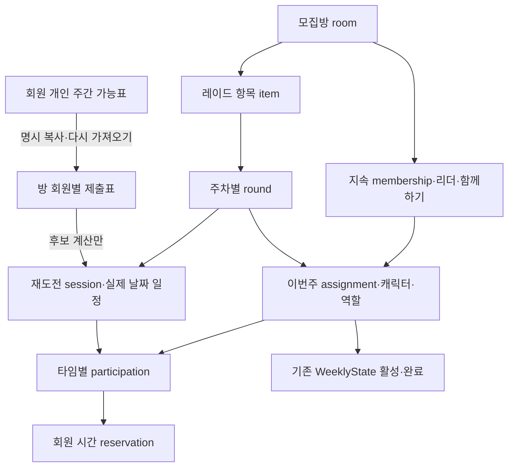

# #13 통합 모집 경계·명령·소비 계약 기획안

**10/20 정정:** [최신정책보완](ISSUE_13_OCT20_POLICY_REVISION.md)이전원동의/배타예약·OFF/미정기간·본인확인/다음주개시등상충부분을대체한다. 아래는원기획/기술보완의이력이므로최신정책으로그대로구현하지않는다.

2026-10-19 / Backend / feat/raid-recruitment / 기준8178c87. **검토용 제안이며 경계 합의·최종 API·구현 완료가 아니다.** 근거와 정정 순서는 [수신대장](../feedback/ISSUE_13_INTEGRATED_REQUIREMENTS_INTAKE.md)의 Flutter24~29번째 및21~22번째를 따른다. 27번째 통합목표를 유지하고 설계확정 뒤 내부 구현단계만 나눈다.

공유: [#13 전체31번째 Backend 기획안](https://github.com/heo0328/lostparty-backend/issues/13#issuecomment-6268024511). 본문 전체를 게시했으며 네이티브가 원격 미게시 문서에 접근해야만 검토할 수 있는 상태로 두지 않았다. 설계 본문 d17a89e 로컬커밋·미push, 다음 Flutter 대조/Backend 보완이다.

## 1. 구조와 수명 제안

현재 단일 Round/Membership을 그대로 확대하면 다음주 구성과 이번주 점유를 분리할 수 없다. 아래 식별·관계를 최소 도메인 경계로 제안한다. 한 행에 모든 상태를 몰거나 지금 장래 프레임워크를 만들지 않는다.

| 자원/UUID | 소유·권한 | 수명/불변조건 |
|---|---|---|
| personal availability | 본인 회원만 GET/PUT | 주간 템플릿, 캐릭터/방과독립. 저장만으로예약/완료생성없음 |
| room / membership | 세션회원·현참가자/리더 | 방정체성/지속자리·다음주함께하기. 그룹membership과분리, 탈퇴/종료때만종료 |
| room submission | 본인작성, 해당방참가자에게제출표공개 | membership+제출revision+원본개인표version을보존. 개인표편집이자동전파되지않음 |
| raid item | room에속함 | raid/difficulty·catalog선택단위. 최초부터item_id발급, 단일레이드도1개item |
| round | item+cycle_key별 | 이번주진행/result·target UUID. open/completed/stopped_incomplete를분리. 다음주새round는별도명령/정책 |
| assignment | membership+round별 | 그주선택캐릭터/역할·snapshot·상태. 종료후지속membership만으로재생성불가 |
| session / participation | round아래타임 / assignment별 | 같은raid의7회재도전은7session, WeeklyState참가/완료7개가아님. 필수/선택과본인명시참가구분 |
| reservation | 회원+session/participation별 | 확정된UTC [start,end)만점유. release시삭제하지않고사유/시각보존, 과거ACK로재생성불가 |

assignment를 현원장의 참가근거로 삼고 WeeklyState는 기존(user, character, raid, cycle) 단일 권위 원장을 재사용한다. 실제예약은 회원(user) 단위이므로 다른원정대/캐릭터로시간겹침을우회하지못한다. reservation은WeeklyState를대체하지않고역할을분리한다.

room_id는공통진입/한도·지속그룹, item/round/session_id는명령대상을특정한다. 단일API도응답에이를명시해다중확장때ID의미를바꾸지않는다. 묶음참가/전체탈퇴·부분완료정책은별도결정전까지단일item이외실행을열지않되통합설계범위에서는영향을확정한다.

최신 대조: [#13 전체32번째 Flutter](https://github.com/heo0328/lostparty-backend/issues/13#issuecomment-6268865657)의 기술 보완을 아래 본문과9절에 반영했다. 구조방향 검토와 제품정책 승인은 구분한다.

## 2. 개인 가능표·복사 계약 제안

**후보 경로** GET/PUT /v1/me/play-availability. 본인세션/서버회원scope이며인증원정대보유는저장조건으로추가하지않는안을추천한다. ‘미저장’과‘저장된빈표’를구분하고GET가행을생성하지않는다.

- 시간대 Asia/Seoul 고정, 요일 ISO1월~7일, local start/end HH:mm 5분단위, end_day_offset=0|1. 24:00 문자열대신00:00/offset1 사용. 시작과종료가같고offset0은거절, offset1은24시간으로구분한다.
- 입력 interval은0보다크고24시간이하. 예: weekday=7/start=23:55/end=00:10/offset1은일요일밤~월요일새벽15분이다.
- 편집 원본 intervals는 검증된 입력 행을 보존하고, 계산용 normalized_intervals는 서버가 분할/중복·인접 병합으로 파생한다. GET는 두 표현을 구분하며 계산표로 편집행을 덮지 않는다. 제안64구간·24시간 상한은 미합의다. 상세 예시는9절이다.
- PUT 전체교체 + expected_version + UUIDv4 Idempotency-Key. timezone/intervals필수, []는의도적가능시간없음. 최초가상version1, 성공변경시증가/no-op유지, stale409·잘못된입력400·타인scope없음. 초기값은전시간가능이아니다.
- GET/PUT 응답후보: {exists,version,timezone,intervals,normalized_intervals,updated_at}. 없을때 exists=false/version1/intervals=[]/updated_at=null. GUI접힘/취소는Flutter로컬동작이며취소PUT는없다. 복구는원ACK와현재GET를구분한다.
- 방별복사명령은 expected_personal_version/expected_submission_revision/expected_membership_revision을받아현재본인표를복사한다. 개인표가바뀌었으면409. 복사후개인표변경은기존제출표/확정예약에영향없음.
- 다시가져오기는명시snapshot교체이며현재확정시간을자동이동하지않는다. 확정예약을수용못하는새제출표는직접반영을거절하고일정변경/탈퇴로안내하는안을추천한다.
- 모집응답은해당방membership참조·제출표와공통후보만공개. 다른방예약세부/개인표전체·전역user UUID는표시하지않고후보차감결과만반영한다.

## 3. 일정·유한 후보·마감 제안

- 일정모드 unscheduled/manual/coordinated와상태 unconfirmed/confirmed/change_pending을분리한다. 미정/클리어시까지는null/명시enum으로유지하고유한구간을만들지않는다. 자동조율예약확정에는유한최대플레이기간이필요하다.
- 주간template→현재cycle의실제KST날짜구간→UTC [start,end)로확장하고cycle창과교차한다. cycle키는수06시유지, 수10시플레이창은별도정책확정전하드코딩하지않는다. 다음주카드/과거이력은현재후보탐색에섞지않는다.
- 첫 round는 room.created_at과같은서버모집개시시각, 반복다음주 round는별도불변 recruitment_opened_at을기준으로 search_floor_at=그시각+30분을저장하는안을제안한다. 기존방의오래된생성시각을다음주에재사용하지않고조회/편집/재가져오기마다재설정하지않는다. 후보는5분격자, 기간은10분이상/5분단위제안이며수동최대시간1~24시간요구와자동조율 기간상한은 별도 입력 제약으로 확인해야 한다.
- 대상membership/해당타임필수또는명시참가assignment의제출표교집합에서각회원의다른활성예약을차감하고기간전체가들어가는후보를오름차순탐색한다. 본session교체시그session의기존예약만제외해자기자신과충돌시키지않는다.
- 현재주차7일·5분격자최대2016시작점과방최대8명의유한탐색을초기안으로삼되부하보장이아니다. 타임일괄조회/편집을쓰고7타임이면7화면요청을강제하지않는다. 다중타임은입력계획순서/후보오름차순의제한backtracking 또는명시시간일괄선택안을제안한다. 탐색예산초과는search_limited로구분하고실제후보없음으로표시하지않는다. 전역재최적화/기존확정재배치는하지않는다. 상세반례/결과분리는9절이다.
- earliest/latest 후보와공대장상한을명시하고실제확정시각은별도다. 마지막출발가능시각=max({s∈유효후보 | 공대장상한이없거나s<=공대장상한}). 상한적용후집합이비면null/후보없음이다. 단순min은불가능/격자밖시각을만들수있어사용하지않는다. 후보없음이기존참가자동해제/다른시각자동이동을뜻하지않는다.
- 신규신청/직접참가/승인의최종검사는 t_db < confirmed_start-30분으로제안한다. 경계동일시각은마감우선(거절). pending신청은자리가아니며마감전신청했다고마감후승인을허용하지않는다.
- **첫 임계치 확정의충돌해소제안:** 아직확정시간없는임계치합류명령도새참가를포함해계산한후보가최종시각 t_db < candidate_start-30분을충족해야만참가/확정/예약을동시에commit한다. 정확히+30분후보가막히면다음5분후보를찾고없으면신규합류실패/기존참가유지. 생성+30분고정하한은바꾸지않으며이추가조건은마감규칙의최종검사다. ‘최초확정명령은마감예외’대안은우회를만드므로추천하지않는다. 이우선순위는합의항목이다.
- 시간경과/미달/지각은확정출발·완료를만들지않는다. 예약의유한구간경과는현재시간충돌대상에서자연히제외되지만결과/assignment/주간원장은명시명령전완료로바뀌지않는다.
- 클리어시까지/상한없는일정은미정으로표현가능하나예약충돌을보호할유한끝이없다. 유한예약확정을차단할지명시종료상한을요구할지합의해야하며기본지속시간을발명하지않는다.

## 4. 서버 명령과 원자성

모든변경은세션actor, UUIDv4 key/정규화body digest·원ACK, game mutation lock, 현재자격/주차/CAS, 최종DB시각검사, 해당자료+결과ACK의단일commit을따른다. provider I/O는lock밖이며정지wrapper는신규증가만막고정리/원ACK는유지한다.

| 명령 | 최종검사와한transaction의효과 |
|---|---|
| 신청 | 현재소유/선택역할/조건/공개권한/마감검사, pending만기록. 예약/슬롯/주간점유없음 |
| 직접가입/승인 | 현재회원·한도·캐릭터/주간/조건·마감/슬롯, assignment+WeeklyState확정. 임계치면현재모든점유/제출표재계산후일정/관련reservation도원자commit. 후보없음신규거절/기존유지안 |
| 최초일정확정 | 리더 또는 명시된 임계치 내부 명령. 임의 확정시각을 누구나 전송하는 공개 API는 만들지 않는다. 대상회원 revision/제출표/소유·주간/candidate 버전과 현재 예약을 재검사한다. |
| 일정변경제안 | 리더가대상session·원일정revision·제안시각/참가집합snapshot을기록. 기존예약유지, 제안만으로새슬롯선점안함 |
| 동의/거절/탈퇴 | 본인대상응답. 전원동의시현재대상집합/주차·예약/조건재검사후기존예약release+신규예약을원자교체. 한명거절은제안거절/원일정유지. 탈퇴는기존권한조건에따라본인정리; 대상집합변경은제안invalidate/새제안추천. 무응답자동동의/타이머/푸시없음 |
| 일반탈퇴 | 본인membership/해당assignment·본인남은reservation/정확히그귀속의WeeklyState활성점유해제. 리더는유효승계선행/마지막1인종료조건유지. 남은회원일정자동이동안함 |
| 본인개인완료 | 통합command에서manual완료+본인해당raid/주차assignment정리+관련본인예약release. 기존manual PUT의참가중guard를그냥없애지않음. 지속방탈퇴/리더승계·묶음잔여처리는아래필수결정 |
| round클리어 | 명시결과권한과현재참가snapshot검사후해당round의완료원장+assignment종료·남은재도전예약release. 권한/타인완료범위미정이면해당명령미활성. 시간경과로실행안함 |
| 이번주미완료종료 | 현재 방 참가자 누구나 대상 이번주 round/CAS로 선언, round를stopped_incomplete로 바꾸고 해당 전체 assignment 종료·남은 session 예약/그 귀속의 WeeklyState 활성점유만 해제.완료필드는기록/변조하지않고지속membership·다음주함께하기·과거이력은유지.취소/자동재개없음 |

예약충돌은회원단위 [start,end) 중첩이며A종료=B시작은허용/간격0. 초기에는기존전역game lock을모든예약writer가공유하고DB의회원+활성UTC구간 배타 제약을 최종 방어로 두는 안을 제안한다. extension/btree_gist의 사용 가능성·앱roleDDL권한/기존합성자료이행을격리검증한뒤선택한다. DBconstraint에의존하지않는writer우회는허용하지않는다. 향후회원별lock최적화는같은정합성을유지할때만별도검토한다.

주차경계/ACK저장실패/예약마지막자리경합은모든변경rollback. 이미다른방assignment로옮긴WeeklyState를옛방release/옛ACK로지우지않도록 round/assignment 귀속generation을내부보존/검사한다. 원래성공ACK는다시효과를실행하지않고현재세션/공개범위/본인관계복구권한을재검사한다.

## 5. 최소 조회·명령 묶음/DTO 제안

새경로는모두후보이며원본OpenAPI에아직추가하지않는다. room_id기존경로는공통context를유지하고다중대상명령은item/round/session을명시한다.

- 개인표 GET/PUT와방제출표 copy/reimport·직접편집 명령. 직접편집도본인revision만바꾸고확정일정이동은별도동의명령을거친다.
- 방일정 GET 1회: {room_id, revision, members_revision, cycle_key, items:[{item_id,round_id,revision,state,sessions:[{session_id,revision,required,schedule_mode,status,confirmed_start,confirmed_end,earliest_start,latest_start,join_deadline,reason}]}], my_assignments, submissions, change_proposals, permissions}. 공개요약에는이private집합을넣지않는다.
- 방일정목록 PUT 1회로타임추가/편집초안과삭제의도(대상ID/revision)를묶되확정예약변경은즉시실행하지않는다. 최대타임7안은요구예시에서확정된상한이아니므로합의전제다. server UUID를유지해재정렬로다른타임이되지않게한다.
- 본인타임참가PUT도 [{session_id,expected_revision,participate}] 일괄입력. 필수타임선택해제로우회불가. 타회원의개인표/예약원문을요청하지않는다.
- 일정변경은proposal_id/revision과accept/reject/leave1명령응답, 원ACK는최소{command_id,target_round_id,revision,executed_at,effect_summary}이고현재상태는GET. 명령별정확한필드는고정계약에서결정한다.
- 이번주미완료종료는 body {round_id,expected_cycle_key,expected_round_revision,expected_membership_id,expected_membership_revision,expected_assignment_revision,...필요한members/schedule revision} 후보. 영향조회가있어도쓰기시재검사한다. 결과는stopped_incomplete/해제수량·선언자membership_ref/서버시각·주차이며타인의전역user UUID/예약세부는노출하지않는다.
- 예상오류분류: 기존401/403/404/400·409 REVISION_CONFLICT/CYCLE_CHANGED/현재예약충돌/모집마감/후보없음, 503 원본 미준비.최종code명은초안에서고정하며REQUEST_IN_PROGRESS Retry-After2/no-store관례를유지한다.

## 6. 전투력·그룹·묶음의 결정 게이트

**전투력:** 동일적용여부와역할별nullable십진문자열문턱을저장한다. 동일모드에서도dealer/support비교값은선택역할원본으로각각검사하며정수반올림/다른역할대체/0fallback금지. UI모드전환시숨긴초안보존은기기편집의도로분리하고서버비교는명시저장값만쓴다.

현재P1은회원이제출한분석표시이고서버검증게임수치가아니다. 일반provider CombatPower를선택역할별게임수치로재해석할근거도없다. 선택대안은 (A) ‘사용자제출분석값’이라고명시하고선택역할/version/관측lifecycle/catalog·필수값/정밀도검사를한값으로조건판정하는제품정책을승인받음(위조방지보장불가), (B) 서버검증가능한선택역할원본/검증규칙을추가확보한뒤활성화다. B근거없이A를게임검증으로표시하거나저장/표시만으로실참가제한완료를주장하지않는다. null/stale일때‘미확인으로참가불가’또는다른예외는명시제품결정이필요하다.

**그룹:** 현재그룹탈퇴자도기존방진행·해당방제출표/참가자료접근을허용하는관계권한을제안하며비그룹인원표시는현재그룹membership으로계산한다. 새그룹방발견/신청·그룹전체자료는현재그룹자격검사를유지한다. 그룹전용↔공개왕복은리더권한/연결그룹선택·기존외부인/신청처리·공개목록회수의결정후고정한다.

**묶음:** room한도는지속membership당1, assignment의각raid/cycle자격과시간예약은별도검사하는안을추천한다. 여러item동시가입은전체성공/실패, 전체탈퇴는명시영향확인후그명령scope의전체를원자해제한다. 하위A완료가B/C참가를자동종료하게하지않는안을추천하되미확정정책으로남긴다. ‘이번주미완료종료’가묶음room아래모든item인지대상raid round인지반드시확정해야하며단일item에서는효과동일하지만임의로다중확대하지않는다.

## 7. 네이티브가 대조할 결정표

| 게이트 | 제안/필요한 결정 |
|---|---|
| 개인표 | KST·5분·익일24h이하·중복합침·64구간·원정대보유조건없음/빈표/복사수명, DTO소비가능여부 |
| 미정/클리어시까지 | 유한예약확정에끝상한필수안과기본미정저장공존. 자동최대기간상한·수10시플레이창/요일 OR·선택일마다의정확한session생성 |
| 확정/마감 | 첫임계치도최종now<후보-30분/동일시각마감우선·후보없음신규전체rollback/기존유지안 |
| 다일타임/동의 | 최대타임·일괄조회편집/입력순 제한탐색·전체표불가능시실패/선택안내. 탈퇴/가입으로동의대상이바뀌면제안무효화안 |
| 완료/이번주종료 | 개인완료의지속membership탈퇴/리더승계·단독종료, round클리어의타인완료권한, 미완료종료의현재assignment자격·묶음대상scope |
| 전투력 | A제출분석판정/B검증원본확보와null/stale정책. 확보전실제문턱강제금지 |
| 묶음/공개왕복 | 한도/전체참가·탈퇴·부분완료와그룹왕복권한/신청외부인처리. 최소구조에 영향을 주는 정책은 지금 확정하고, 구조를 바꾸지 않는 미래 UI 상세만 후속으로 둔다. |

이표는임의기본값으로구현하겠다는뜻이아니다. Flutter가확정기준충돌/소비문제/선호안을회신하고제품결정이필요한항목만사용자에게연결한다. 경계확정전에‘단일개인표만완료’로전체구현착수를대체하지않는다.

## 8. 기존자료/API 이행·구현 순서

- F1/F2 transaction/ACK·권한/slot·카탈로그·주간원장과정지/준비검사·snapshot은재사용하되 단일유한Round와Membership의회차귀속을분리한다. 기존성공ACK/ID·역사를유지하는추가migration/adapter를설계하고커밋migration재작성·강제stamp/자료초기화는안한다.
- 구후보room_id→동일room+1item, 기존round→그item의동일round+1session, 기존membership→동일지속membership+기존round assignment와session participation으로매핑하는안을제안한다. 기존유한구간에서합법reservation을만들수없는자료/기존중복은검출하고활성화를막는다. 임의시간/0건으로우회하지않는다.
- 실제개발DB는아직0016/모집미적용이라개발자료이행과격리구후보자료호환을구분한다. 활동브랜치migration과dev head를통합계획에서대조한다. 기존원본API를무조건자동schema로덮지않고새기획의필수필드/경로를고정후원본OpenAPI와맞춘다.
- 구현게이트: 경계/결정대조·확정 → 개인표/제출표+방/item/round/assignment영속기반 → 명시참가/주간원장·타임/예약/자동확정 → 변경동의/탈퇴·완료/미완료종료 → 전투력/그룹·묶음확정분기 및통합회귀 → 검증구간commit/push·최신이미지/DB/실행계약동시전환·필요인계. 이는통합목표내부순서이며축소목표회귀가아니다.
- 표적검증: 템플릿 익일/주말/주차·정밀도·빈표/타인/GET 쓰기0·cache/재전송·임계치/마감/시각경계·같은회원 다른캐릭터/동시확정·마지막동의후충돌·필수/선택/7타임·지연응답·소유상실/탈퇴·개인/round완료/미완료경합·다른방재참가후옛ACK·미래구성/이력보존 및0016/구후보자료보존을포함한다.
- 이번에는 기획을 위한 코드·문서 대조만 수행했다. 코드/DDL/원본OpenAPI·서버/DB/이미지·자동시험/실provider/기기시험을 실행/변경하지 않았고 성능SLO/운영완료를 보장하지 않는다.

## 9. Flutter32번째 기술 보완·비교 예시

[전체33번째 Backend 기술 보완 회신](https://github.com/heo0328/lostparty-backend/issues/13#issuecomment-6269041117)에 아래 내용을 게시했다. 기술 수정1e2f706 로컬커밋·미push, 다음 Flutter 필요한 사용자결정/대조 및 Backend 계약반영이다.

### 편집행과 계산표

편집 PUT 예시: {weekday:3,start:"23:00",end:"03:30",end_day_offset:1}. 같은 version의 GET intervals는 이 수요일23시~목요일03:30 행을 그대로 반환한다. normalized_intervals만 수[23:00,24:00)/목[00:00,03:30) 계산구간으로 분할한다. 목요일02:00~04:00 행이 추가되면 계산상 목요일[00:00,04:00)로 합쳐도 GET의 편집행2개는 그대로 복원한다. 실날짜 확장은 해당주 수23시~목03:30 UTC 변환을 한 번 적용한다. normalized의1440은 내부 끝 경계이며 편집 end="24:00"을 요구하지 않는다. 주말 wrap은 다음 ISO주 시작에 연결하고 실제검색cycle와 교차한다.

하나의원본(version)이두표현의권위다. 클라이언트가normalized를따로수정/저장하거나분할행을다시원본으로PUT하지않는다. 본인방제출표복사도편집원본·계산파생·source_version을같은revision으로묶는다.

### 마지막 후보 계산의 정정

유효시작 {19:00,22:00}, 공대장상한21:00이면 latest=19:00이다. min(22:00,21:00)=21:00은실제후보가아니다. 유효시작 {19:00,19:05}, 상한19:03이면19:00이며격자밖19:03을반환하지않는다. 상한18:55면null/후보없음이다. 전체다중타임계획의latest라고표시하려면완성배치가가능한후보에한해계산하고제한탐색으로판정못한것은계산한계로응답한다.

### 반복 round의 하한 기준 자원

제안은 round.recruitment_opened_at/immutable search_floor_at이다. 최초는방생성transaction의DB시각과동일값, 다음주는해당round의명시모집개시/정해진서버개시이벤트의DB시각으로한번저장한다. next round초안/반복설정복사만으로모집개시·assignment/주간점유를만들지않는다. 반복주차개시를누가언제실행할지는제품정책대상이며오래된room.created_at을다음주하한으로재사용하지않는다. 검색은stored floor·현재cycle·과거후보제외를교차하며GET마다now+30분으로stored floor를변경하지않는다. 수06~10플레이창제외는별도미정이다.

### 다중 타임의 탐색 한계와 명시 선택

같은회원이참가하는1시간session A의가능시작이10:00/11:00, B가10:00뿐이면탐욕A10:00→B실패지만B10:00/A11:00은가능하다. 따라서탐욕실패를no_candidate로정의하지않는다.

제안은현재주차·이번명령의미확정대상session만대상으로계획순/오름차순후보의제한backtracking을한다. 다른방/기존확정예약은고정장애물이며전역재배치하지않는다. 전체유한탐색을끝내고불가능을확인한경우만no_candidate, 예산초과는search_limited(미확인)·필요시수동조정, 원본revision변경은stale로분리한다. 제한숫자/최대타임/응답시간은격리성능측정후계약으로정하고7타임예시를상한으로고정하지않는다. 자동경로가제한에걸려도정확한UTC시작배열을명시선택해제출하는대안은모든필수/선택참가·개인/제출표·기간/마감·현재예약을같은최종transaction에서전부검사해가능한조합만확정한다. 후보결과/검색토큰은예약이나실패없는보장이아니다.

### 첫 임계치·마감의 두 정책 비교 — 미채택

방생성09:00, 고정하한09:30, 첫임계치합류최종DB시각09:00, 공통후보09:30/09:35 예시:
- Backend안: 09:00<09:30-30분은거짓이므로09:30확정불가. 09:35로확정가능하면참가/예약과함께성공. 09:30밖에없으면신규합류실패/기존참가유지.
- Flutter추천대안: 미확정방의임계치합류를성공시키며09:30을최초확정하고추가모집즉시마감. 그뒤신규신청/참가거절. 최초합류가예외인지정확히명세해야한다.

이는출발하한재설정의차이가아니라첫임계치명령의마감적용예외여부다. 어느안도이번회신으로자동채택하지않고사용자선택후고정한다. 확정후신청/즉시참가30분전마감은확정요구, pending승인마감동일적용은우회방지추천으로구분한다.

### 귀속·revision 및 미정 정책 보존

copy/reimport→submission revision/source_version, 변경→proposal revision+참가집합/plan revision, 확정/해제→assignment generation+session/예약ID·reservation revision, WeeklyState→원장revision+현재정확귀속을공유명령경로로검사한다. 다른방으로옮긴새점유와귀속이불일치하면옛방의해제가그행을지우지않고다른부분과함께rollback/명시충돌로처리하는안을제안한다. 원ACK는과거효과만반환하고새예약을생성/해제하지않는다.

함께하기지속membership은가입중방수에포함하는기존기준을유지하며이번주종료로한도를초기화하지않는다. 묶음1room한도/정원·4/8혼합/전체가입·탈퇴/A만완료/종료scope·선언현재assignment필요여부는미정이다. 개인표로그인회원API제안과미인증카드노출/수정UX는별도결정이며본문의저장조건없음안도승인이아니다. P1 A/B·null/stale, 그룹왕복외부인/pending/비그룹리더/연결그룹, 동의대상변경시무효화안도최종결정전이다.

디자인은별도Penpot채팅이며디자인도구한도를이계약설계의선행조건으로두지않는다. 이번기술보완은문서/예시검토이며코드/DDL/원본OpenAPI·서버/DB/시험·배포승인이아니다.
